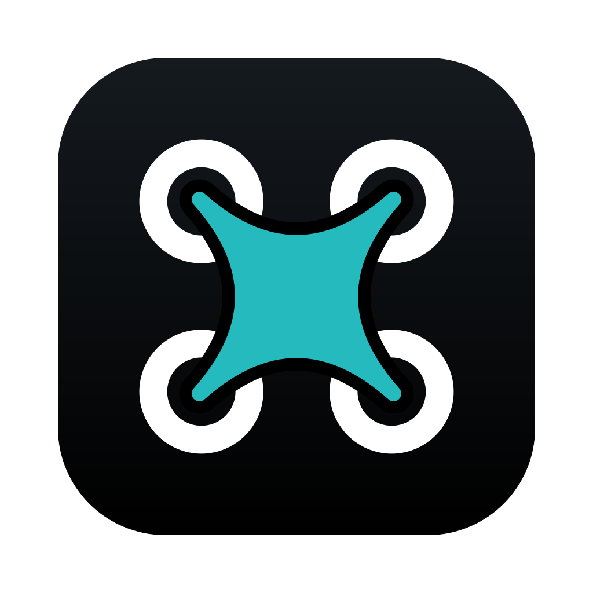
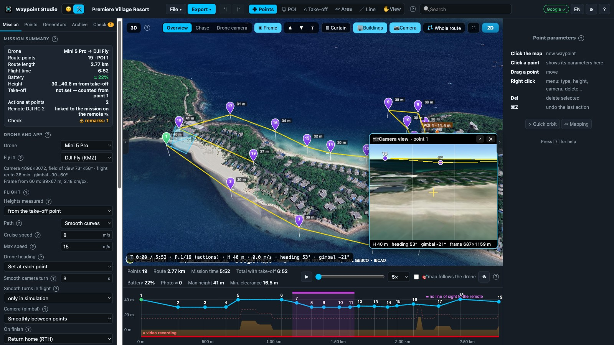
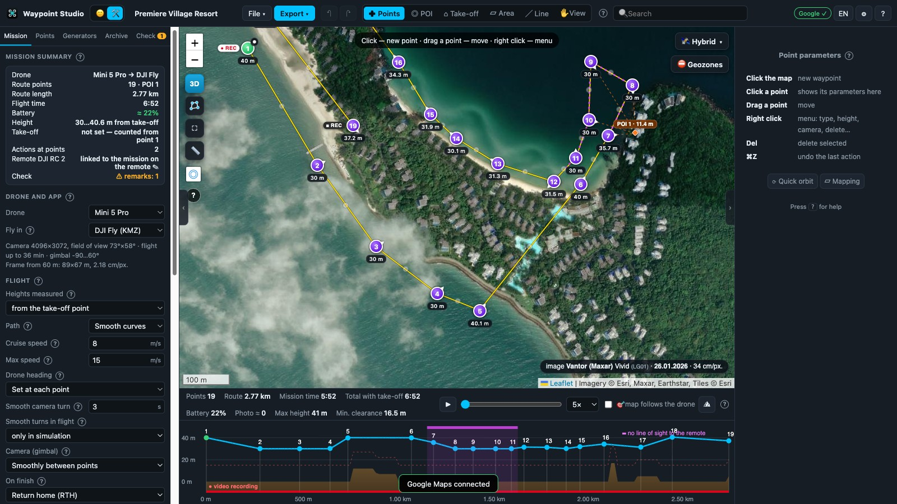

<p align="center"></p>

# Waypoint Studio — free DJI waypoint mission planner for Mac

**Plan cinematic drone flights on a satellite map, check them in 3D, watch the flight from the drone's camera — and
send the mission straight to your DJI RC 2 over USB. Free.**

Waypoint Studio is a desktop route planner for DJI drones (Mini 4 Pro, Mini 5 Pro, Air 3, Mavic 3/4 and other DJI Fly /
DJI Pilot 2 aircraft). It works like Litchi Mission Hub, but runs locally on your Mac, shows every route in 3D over real
terrain, and simulates the whole flight before you take off.

[**⬇ Download for macOS (Apple Silicon)**](https://github.com/DRF675717/waypoint-studio/releases/latest) ·
[☕ Support the project on Buy Me a Coffee](https://buymeacoffee.com/6757172/e/594190) · [Русская версия ниже](#по-русски)



▶ **[Watch a 30-second 3D flight preview (MP4)](docs/media/waypoint-studio-3d.mp4)** · more screenshots: [chase view](docs/media/3d-chase.jpg), [drone camera](docs/media/drone-camera.jpg)

## Features

* **Map & 3D** — satellite / hybrid / topo maps (Esri, Google, Airbus/CNES, Vantor/Maxar with your key), photorealistic
  3D view with terrain and buildings, the camera frame pyramid at every point.
* **Flight simulation** — play the route in 2D or 3D, chase view behind the drone, live drone-camera window, start from any
  waypoint, height profile with terrain clearance.
* **Every DJI setting per waypoint** — height, speed, curve, heading (along the path / POI / custom angle / manual), gimbal
  tilt, zoom, actions (photo, video, hover, rotate, tilt), interval photos, multiple POIs, smooth camera turns.
* **Pre-flight check** — terrain clearance, legal height, distance, battery use, app limits (points, actions), official
  no-fly zones, line of sight to the remote, sun and golden hour, wind forecast.
* **Generators** — orbit / spiral, cinematic shots (dronie, rocket, reveal, fly-by, approach), area mapping
  (photogrammetry grid), corridor, building facade, whole-route transform and terrain following.
* **Export** — DJI Fly KMZ (also split by battery), DJI Pilot 2 KMZ, Litchi CSV, Google Earth KML with a virtual flight,
  GPX, GeoJSON. Import of all of them.
* **DJI RC 2 over USB** — open missions from the remote, edit them, write them back with a byte-by-byte check and an
  automatic backup.
* **Plan vs. real flight** — load an Airdata / FlightReader / Litchi CSV log and see where the drone deviated.
* **English and Russian interface.** Light updates install in seconds.



## Install

1. Download `WaypointStudio-<version>-macOS-arm64.zip` from [Releases](https://github.com/DRF675717/waypoint-studio/releases/latest)
   and unzip it.
2. Move **Waypoint Studio.app** to *Applications*.
3. The app is not notarized by Apple, so the first time open Terminal and run
   `xattr -dr com.apple.quarantine "/Applications/Waypoint Studio.app"`, then open it normally
   (or right-click → Open).

Requires macOS 12+ on Apple Silicon (M1 or newer). Free maps work without keys; Google Maps, Cesium ion (photorealistic
3D), Airbus and Maxar keys are optional and are stored only on your Mac.

## Safety

The pilot is responsible for every flight. Always check the route, local rules, no-fly zones, weather and battery before
take-off and keep the drone in visual line of sight.

## Support

Waypoint Studio is free. If it saves you time on a shoot, you can [buy me a coffee](https://buymeacoffee.com/6757172/e/594190) — it keeps the updates coming.

## License

Freeware — free to download and use, including for paid drone work; modification and resale are not allowed. See
[LICENSE](LICENSE). Third-party components: [THIRD_PARTY.md](THIRD_PARTY.md). DJI and Litchi are trademarks of their
owners; this project is independent and not affiliated with them.

---

## По-русски

Waypoint Studio — бесплатный планировщик маршрутов съёмки для дронов DJI на Mac: карта и 3D над рельефом, симуляция
полёта с видом из камеры, проверка маршрута (рельеф, зоны, батарея, ограничения приложения), генераторы (орбита,
кинокадры, картирование, коридор, фасад), экспорт в DJI Fly / DJI Pilot 2 / Litchi / Google Earth и запись заданий
прямо на пульт DJI RC 2 по USB. Интерфейс на русском и английском.

### Для разработки

| Папка | Что внутри |
|---|---|
| `app/` | интерфейс (HTML/CSS/JS): карта, 3D, симуляция, проверки, экспорт, пульт, переводы (`js/i18n-en.js`) |
| `desktop/` | оболочка Electron: `main.js` — загрузчик, `core.js` — программа (локальный сервер, пульт, обновления) |
| `bridge/` | `wsbridge.c` — USB-помощник для пульта DJI RC 2 (libmtp) |
| `tests/` | `run.js` — автотесты, `fuzz.js` — случайные маршруты, `uiaudit.js` — проверка интерфейса на обоих языках |
| `tools/` | сборка (`build.sh`, `mkupd.sh`, `mklight.sh`) и правка переводов (`retip.py`, `setdict.py`) |

```
cd app && python3 -m http.server 8765      # запуск в браузере (без пульта, геозон и обновлений)
npm i -D playwright@1.60.0 && npx playwright install chromium
node tests/run.js                          # автотесты + 120 случайных маршрутов
node tests/fuzz.js 300 7                   # больше случайных маршрутов: <количество> <seed>
node tests/uiaudit.js                      # обрезанные / перекрытые надписи, непереведённые тексты
npx eslint                                 # статическая проверка
```

Обновления: полное (~116 МБ) — при смене Electron, USB-помощника или загрузчика; лёгкое (~250 КБ) — всё остальное,
ставится в `~/Library/Application Support/Waypoint Studio/live/<версия>` и откатывается само, если окно не открылось.
Программа берёт обновления из GitHub Releases.

Известное ограничение: при обратном чтении KMZ для DJI Pilot 2 с режимом камеры «Не управлять» маршрут из двух точек,
где в обеих точках первое действие — «Наклон камеры», читается неоднозначно.
